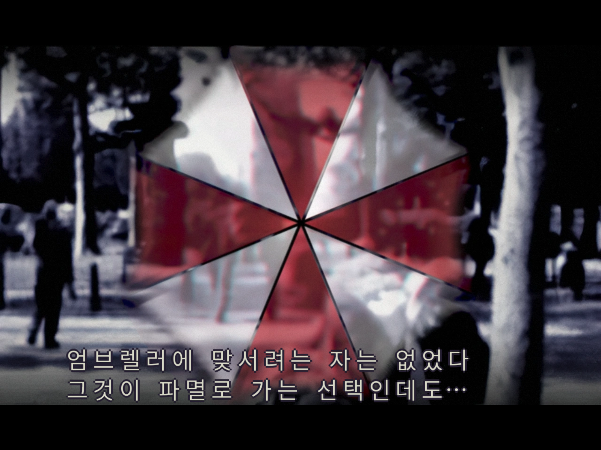
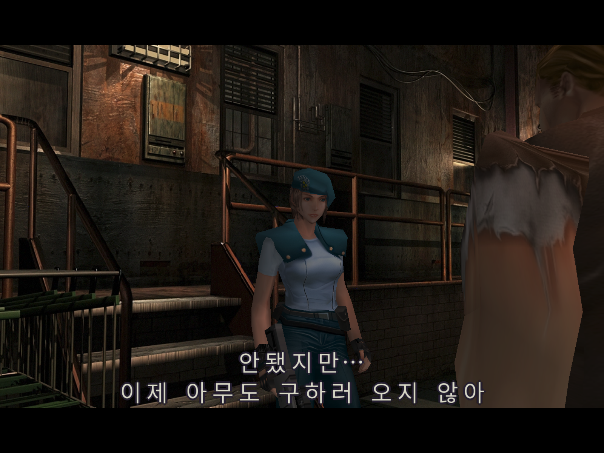
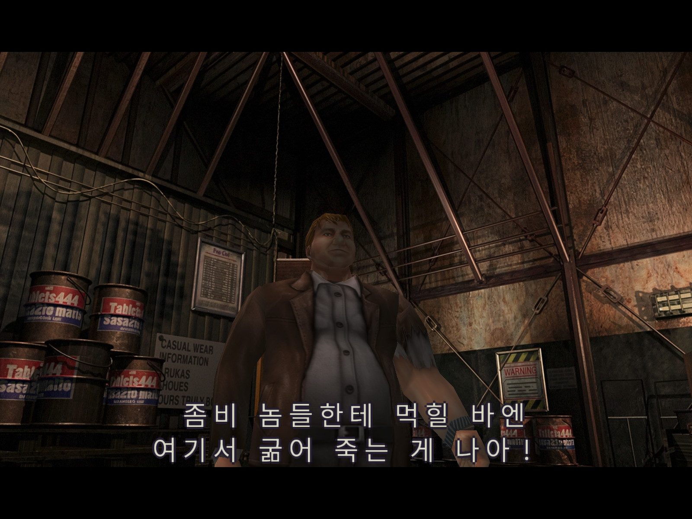
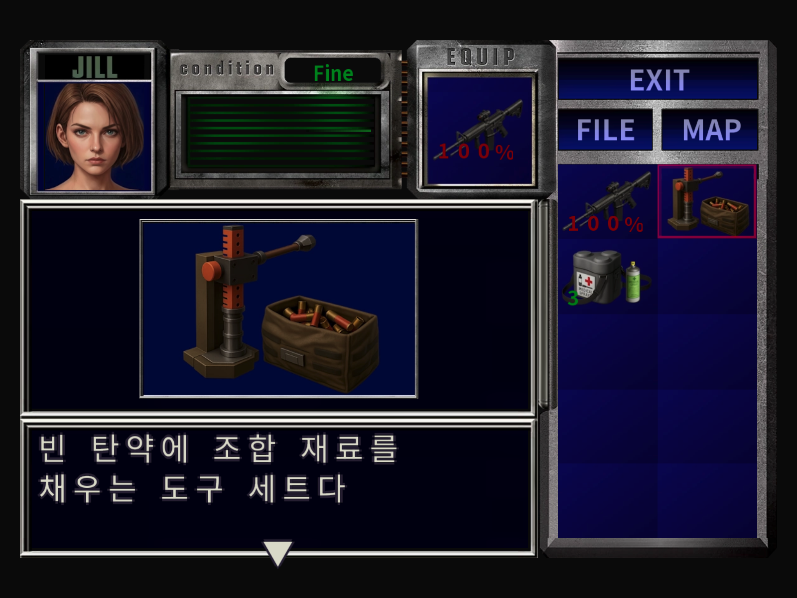
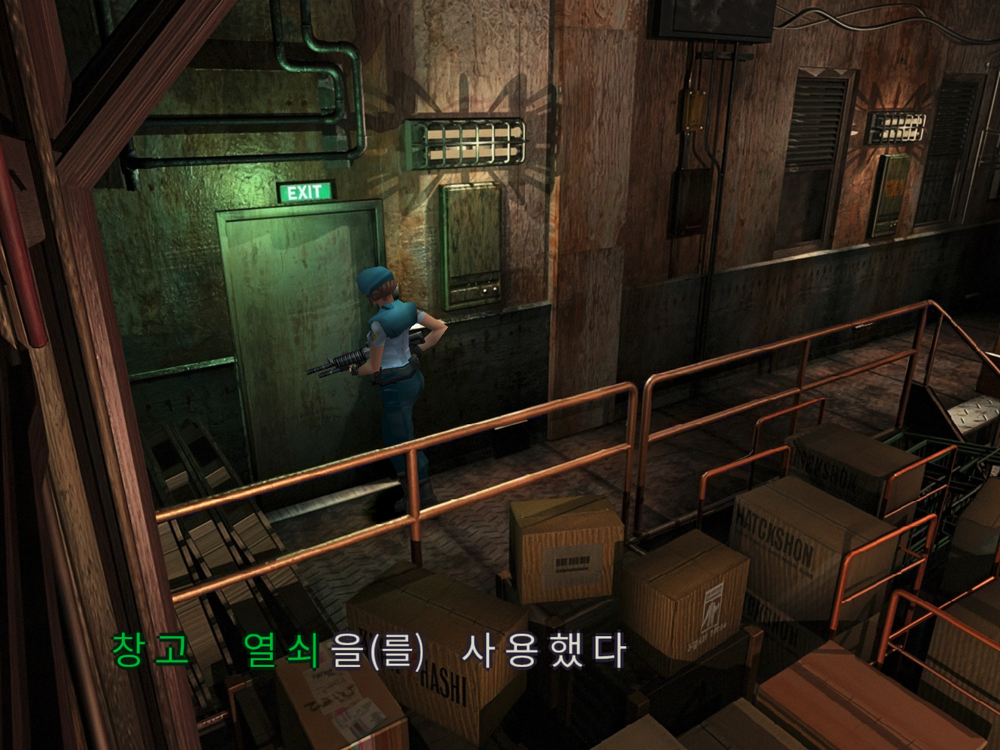
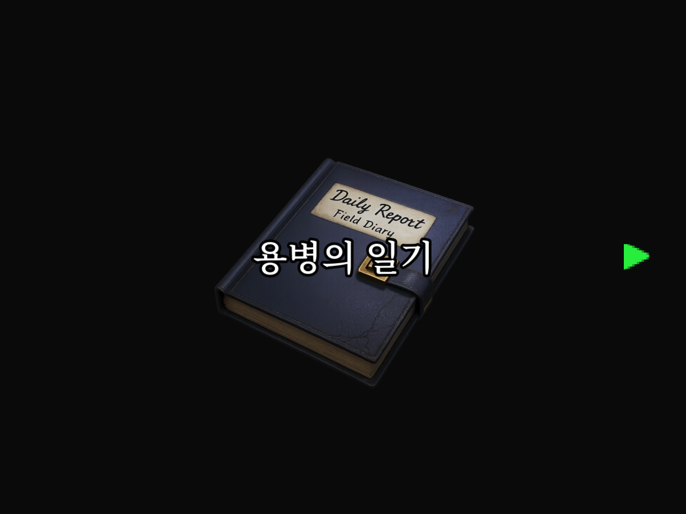
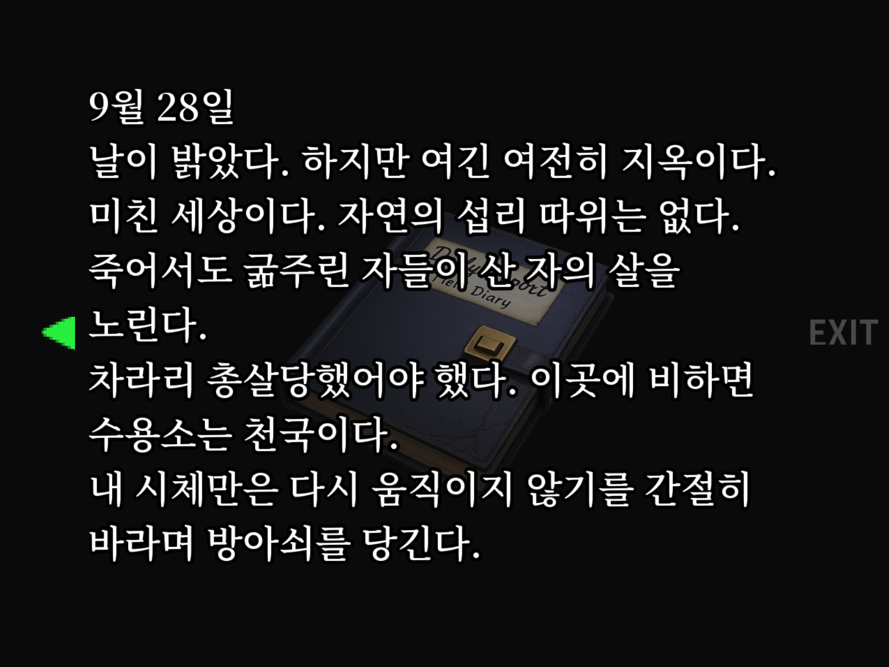
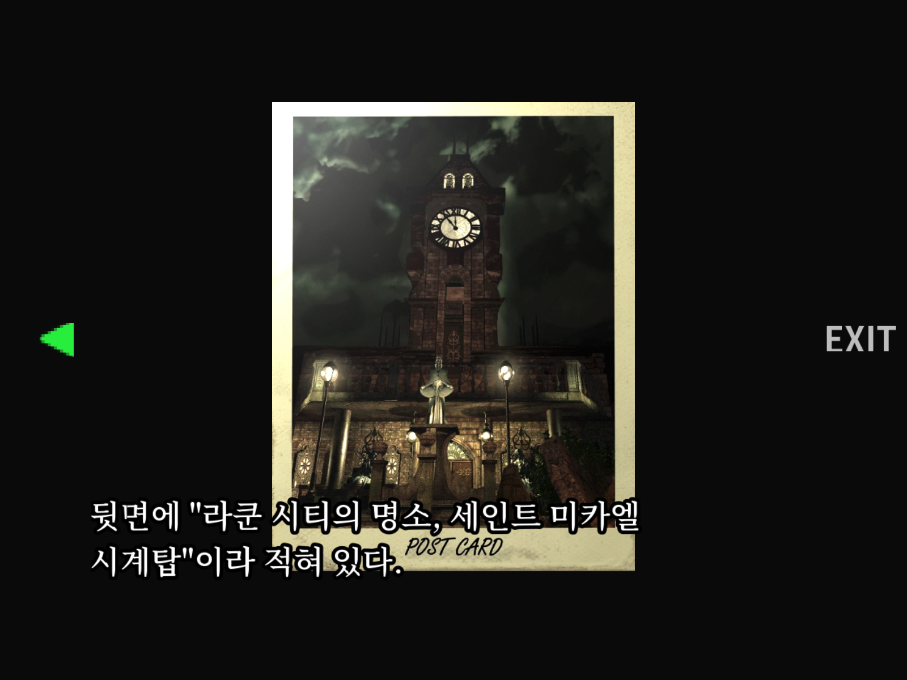

# BIOHAZARD 3 Korean HD

Classic REbirth로 실행하는 **BIOHAZARD 3 PC**에서 한글로 플레이할 수 있게 해 주는 모드입니다.
대사, 아이템, 파일 목록, 문서, 상태 화면, REbirth 메뉴(키 설정, 저장, 불러오기)가 한글로 나옵니다.

## 스크린샷

<table>
  <tr>
    <td width="50%"></td>
    <td width="50%"></td>
  </tr>
  <tr>
    <td width="50%"></td>
    <td width="50%"></td>
  </tr>
  <tr>
    <td width="50%"></td>
    <td width="50%"></td>
  </tr>
  <tr>
    <td width="50%"></td>
    <td width="50%"></td>
  </tr>
</table>

## 설치 (권장)

먼저 가지고 있는 판에 맞는 [Mulderland Enhancement Pack](https://www.mulderland.com/en/games/resident-evil-3-nemesis)을 설치합니다. Classic REbirth와 HD 텍스처가 함께 설치됩니다.

- **GOG판:** GOG에서 Resident Evil 3 Nemesis를 **일본어(Japanese)판**으로 받은 뒤 **GOG Enhancement Pack**을 설치합니다. 게임 폴더는 GOG 설치 폴더입니다.
- **Steam판:** **Steam Enhancement Pack**을 설치합니다. REbirth가 Steam 설치 폴더 안의 `rebirth` 폴더에 설치되며, 이 `rebirth` 폴더가 게임 폴더입니다.

팩을 설치할 때 "Graphical improvements"(HD 텍스처)는 켜고, 일본어 데이터를 지우는 "Free space" 옵션은 끕니다.

그다음 한글 모드를 설치합니다.

1. 게임을 끄고, [Releases](../../releases)의 `re3-korean-hd-<버전>.zip` 내용을 게임 폴더에 그대로 복사합니다. 게임 폴더는 `BIOHAZARD(R) 3 PC.exe`와 `ddraw.dll`이 있는 곳이며, 압축 파일 안의 `mod_korean_hd/`, `hires/`를 덮어씁니다.
2. `config.ini`의 `[DLL]`에서 `JapaneseEnable = 1`인지 확인합니다. 한글은 일본어 글꼴 경로로 출력됩니다. REbirth는 종료할 때 `config.ini`를 다시 쓰므로 게임이 꺼진 상태에서 바꿉니다.
3. 게임을 실행하고 REbirth 모드 목록에서 **BIOHAZARD 3 - Korean HD**를 고릅니다. 실행 옵션에 `-dev_korean_hd`를 넣으면 목록 없이 바로 시작합니다.

## 제거

- 게임 폴더의 `mod_korean_hd/`를 지웁니다.
- `hires/`에 덮어쓴 HD 텍스처는 Enhancement Pack을 다시 설치해 되돌립니다.

## 크레딧과 권리

- **[Classic REbirth](https://classicrebirth.com/)** Gemini. 
- **글꼴:** Noto Sans KR, Noto Serif KR. SIL Open Font License이며 `assets/fonts/`에 라이선스가 함께 있습니다.
- **코드:** [LICENSE](LICENSE).
- **게임:** BIOHAZARD 3는 CAPCOM의 저작물입니다. 이 저장소에는 게임 전체 데이터가 포함되지 않습니다. 번역 그래픽 조각과 엔딩 텍스처 참조 이미지, 배포 zip의 한글 그래픽은 게임에서 파생한 자료입니다.
